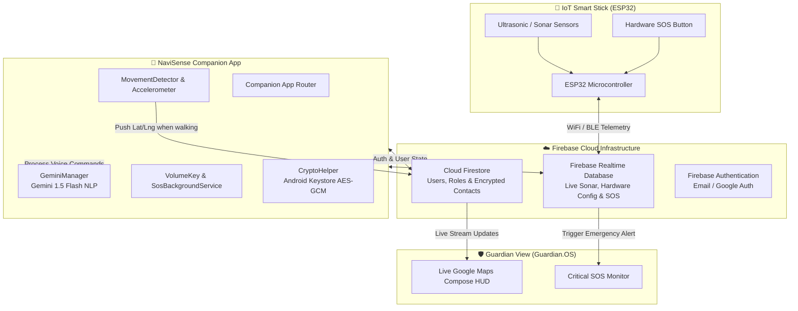

# 🧭 NaviSense

<p align="center">
  <strong>An Intelligent IoT and AI-Powered Assistive Navigation & Guardian Ecosystem for the Visually Impaired</strong>
</p>

<p align="center">
  
  
  
  
  
  
</p>

---

## 📖 Overview

**NaviSense** is an end-to-end assistive navigation and safety ecosystem developed to empower visually impaired individuals while providing complete peace of mind to their caregivers and guardians. 

NaviSense bridges mobile accessibility, cloud intelligence, and IoT hardware. By combining **Google Gemini AI** for natural voice interaction (supporting bilingual English and Hindi/Hinglish phrasing), **ESP32 ultrasonic smart stick telemetry**, **real-time background GPS tracking**, and an **AES-GCM encrypted security layer**, NaviSense transforms everyday mobility into a secure, accessible, and connected experience.

---

## 🌟 Key Features

### 🦮 For Visually Impaired Users (`Blind Mode`)
- **🎙️ AI Voice Command Agent**: Integrated with Google Gemini (`gemini-1.5-flash`) and offline regex fallbacks. Understands natural language and colloquial phrases in English and Hinglish (e.g., *"mujhe metro station le chalo"*, *"airport jana hai"*, *"call my guardian"*).
- **🚶 Movement & Step Detection**: Utilizes device accelerometer sensors (`TYPE_LINEAR_ACCELERATION`) with step debouncing to detect walking vs. standing still in real time, pushing GPS coordinates only while in motion to conserve battery.
- **🦯 Smart Stick Calibration & Sonar HUD**:
  - Live obstacle proximity display in centimeters straight from the stick's sonar sensor.
  - Remote hardware calibration: adjust detection range (0.5m – 4.0m), warning frequency, auto-off timers, battery saver toggles, tone pitch, and speech volume over Firebase RTDB.
- **🚨 Multi-Modal SOS Triggers**:
  - **Hardware Key Combo**: Press Volume Up + Volume Down simultaneously.
  - **Accessibility Service Interception**: Volume Down long-press / shortcut via `VolumeKeyService`.
  - **Stick Panic Button**: Automated edge-triggered emergency phone dialer via `SosBackgroundService`.
  - **On-Screen Tactile FAB**: Accessible high-contrast SOS emergency button with haptic feedback.
- **🛡️ AES-256-GCM Encrypted Trusted Contacts**: Uses Android Keystore (`AndroidKeyStore`) hardware-backed encryption to protect contacts, relations, and phone numbers before writing them to the cloud.
- **🌤️ Environmental Safety & Weather**: Live weather, visibility indices, and nearby hazard alerts powered by location services.
- **🔊 Full Voice Feedback (TTS)**: Built-in Text-To-Speech with Indian English (`en-IN`) acoustic tuning.

### 🛡️ For Caregivers & Families (`Guardian.OS`)
- **🔑 Seamless Device Pairing**: Pair in seconds via a unique 6-character alphanumeric Companion ID (`UUID`).
- **🗺️ Live Telemetry & GPS Tracking**: Google Maps Compose interface tracking the blind person's real-time coordinates, walking state, and last timestamp.
- **🚨 Instant Critical SOS Dashboard (`GuardianSOSScreen`)**: Immediate critical alerts when an emergency is activated, showing precise coordinates, cellular strength, and one-tap emergency call dialing.
- **⚙️ Mesh Governance**: Remote permission management (live audio access, location history retention, SOS push notifications).

---

## 🏗️ System Architecture



---

## 📁 Repository Structure

```
NaviSense/
├── AndroidProjects/
│   └── companion_app/
│       ├── app/
│       │   ├── src/
│       │   │   ├── main/
│       │   │   │   ├── java/
│       │   │   │   │   ├── MovementDetector.kt            # Accelerometer sensor & step counter flow
│       │   │   │   │   └── com/example/companion/
│       │   │   │   │       ├── MainActivity.kt            # App entry, volume-key SOS & routing
│       │   │   │   │       ├── BlindHomeScreen.kt         # Accessible home screen for blind user
│       │   │   │   │       ├── BlindNavigationScreen.kt   # Intent router for turn-by-turn navigation
│       │   │   │   │       ├── BlindContactsScreen.kt     # Trusted emergency contact list
│       │   │   │   │       ├── BlindViewModel.kt          # Bluetooth state & device RSSI management
│       │   │   │   │       ├── BluetoothSettingsScreen.kt # BLE & Classic Bluetooth hardware scanner
│       │   │   │   │       ├── CryptoHelper.kt            # Hardware Keystore AES-GCM encryption
│       │   │   │   │       ├── EmergencyProtocolScreen.kt # Primary SOS configuration & dialer setup
│       │   │   │   │       ├── FirebaseManager.kt         # Firestore queries & real-time listeners
│       │   │   │   │       ├── GeminiManager.kt           # Google Gemini AI prompt orchestration
│       │   │   │   │       ├── GoogleAuthHelper.kt        # Google Sign-In credential client
│       │   │   │   │       ├── GuardianConnectScreen.kt   # 6-digit Companion ID connection portal
│       │   │   │   │       ├── GuardianHomeScreen.kt      # Google Maps live tracking for guardians
│       │   │   │   │       ├── GuardianScreen.kt          # Guardian.OS telemetry & configuration
│       │   │   │   │       ├── GuardianSOSScreen.kt       # Critical alert & telemetry monitoring
│       │   │   │   │       ├── GuardianStorage.kt         # SharedPreferences guardian storage
│       │   │   │   │       ├── LandingScreen.kt           # Welcome & role selection screen
│       │   │   │   │       ├── LocationTracker.kt         # FusedLocationProviderClient wrapper
│       │   │   │   │       ├── LoginScreen.kt             # Firebase email/password authentication
│       │   │   │   │       ├── PermissionHandler.kt       # Runtime permissions requester
│       │   │   │   │       ├── ProfileScreen.kt           # User profile & account management
│       │   │   │   │       ├── SignUpScreen.kt            # Account creation & role registration
│       │   │   │   │       ├── SosBackgroundService.kt    # Background service listening for SOS
│       │   │   │   │       ├── StickScreen.kt             # IoT Stick telemetry & hardware tuning
│       │   │   │   │       ├── UniqueIdManager.kt         # 6-character unique ID generator
│       │   │   │   │       ├── VolumeKeyService.kt        # Accessibility service for key detection
│       │   │   │   │       └── ui/theme/                  # Jetpack Compose Theme, Colors & Typography
│       │   │   │   ├── res/                               # Vector drawables, themes, mipmap & XML configs
│       │   │   │   └── AndroidManifest.xml                # Permissions, services & metadata
│       │   │   └── test/ & androidTest/                   # Unit and instrumentation tests
│       │   ├── build.gradle.kts                           # Module-level Gradle build configuration
│       │   └── proguard-rules.pro                         # ProGuard obfuscation rules
│       ├── gradle/
│       │   ├── libs.versions.toml                         # Version catalog for dependencies
│       │   └── wrapper/                                   # Gradle wrapper binaries
│       ├── build.gradle.kts                               # Project-level Gradle build file
│       ├── gradle.properties                              # JVM & AndroidX build parameters
│       └── settings.gradle.kts                            # Module inclusion & repository definitions
└── README.md                                              # Project documentation
```

---

## 🛠️ Technology Stack & Libraries

| Category | Technology | Purpose |
|---|---|---|
| **Language** | Kotlin (Java 11 target) | Core Android application development |
| **UI Framework** | Jetpack Compose + Material 3 | Modern, declarative, accessible reactive UI |
| **Artificial Intelligence** | Google Generative AI SDK (`gemini-1.5-flash`) | Context-aware voice command intent extraction |
| **Cloud & Backend** | Firebase Auth, Firestore, Realtime Database | Real-time synchronization, telemetry & authentication |
| **Mapping & Location** | Google Maps SDK + Maps Compose (`maps-compose:4.3.0`) | Guardian live tracking & user navigation |
| **Hardware / IoT** | ESP32 Microcontroller + Sonar + BLE | Smart cane obstacle detection & telemetry |
| **Security** | AndroidKeyStore (`AES/GCM/NoPadding`) | Local cryptographic hardware encryption for contacts |
| **Speech & Audio** | Android `TextToSpeech` & `RecognizerIntent` | Bidirectional voice synthesis and recognition |
| **Async & Streaming** | Kotlin Coroutines & StateFlow | Reactive sensor events and real-time database listeners |

---

## 🔐 Security & Privacy Architecture

NaviSense is built with privacy-first engineering:
1. **Hardware-Backed Encryption**:
   - `CryptoHelper.kt` generates an AES key stored securely inside the Android Keystore (`ContactSecurityKey`).
   - All contact data (names, phone numbers, relations) is encrypted with **AES/GCM/NoPadding** prior to Firestore storage.
2. **Access Control**:
   - Only linked guardians using the authorized 6-character Companion ID can read location telemetry.
   - Background location polling is deactivated automatically when the user is stationary.

---

## 🚀 Getting Started

### Prerequisites
- **Android Studio Ladybug (or newer)**
- **JDK 11+**
- Android device running **Android 8.0 (API level 26)** or higher with Bluetooth LE and Google Play Services.
- Google Cloud & Firebase Console accounts.

### 1. Clone the Repository
```bash
git clone https://github.com/Viperz6884/NaviSense.git
cd NaviSense/AndroidProjects/companion_app
```

### 2. Configure Firebase
1. Create a Firebase project at [Firebase Console](https://console.firebase.google.com/).
2. Enable **Authentication** (Email/Password, Google Sign-In), **Cloud Firestore**, and **Realtime Database**.
3. Download `google-services.json` and place it in:
   ```
   AndroidProjects/companion_app/app/google-services.json
   ```

### 3. Add API Keys
Create or update `local.properties` in `AndroidProjects/companion_app/`:
```properties
MAPS_API_KEY=your_google_maps_api_key_here
```
In `GeminiManager.kt`, supply your Google Gemini API key or inject it securely via build configuration:
```kotlin
val model = GenerativeModel(
    modelName = "gemini-1.5-flash",
    apiKey = BuildConfig.GEMINI_API_KEY
)
```

### 4. Build and Run
Open the project in Android Studio, sync Gradle, and run on your test device:
```bash
./gradlew assembleDebug
```

---

## 📡 Firebase Realtime Database Schema (IoT Telemetry)

```json
{
  "NaviSense": {
    "Live": {
      "distance_ahead": 45
    },
    "Config": {
      "battery_saver": true,
      "auto_off_mins": 15,
      "detection_range_m": 2.5,
      "warning_freq_s": 1.0,
      "voice_volume": 0.8,
      "tone_pitch": 1.0
    },
    "Critical": {
      "SOS_ACTIVE": false
    }
  }
}
```

---

## 🤝 Contributing

Contributions make the open-source community an amazing place to learn, inspire, and create. Any contributions to improve NaviSense are **greatly appreciated**!

1. Fork the Project
2. Create your Feature Branch (`git checkout -b feature/AmazingFeature`)
3. Commit your Changes (`git commit -m 'Add some AmazingFeature'`)
4. Push to the Branch (`git push origin feature/AmazingFeature`)
5. Open a Pull Request

---

## 📄 License

Distributed under the MIT License. See `LICENSE` for more information.

---

<p align="center">
  Built with ❤️ for a safer, more accessible world.
</p>
